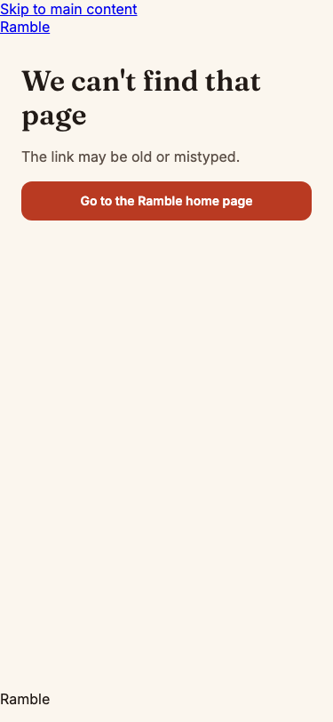
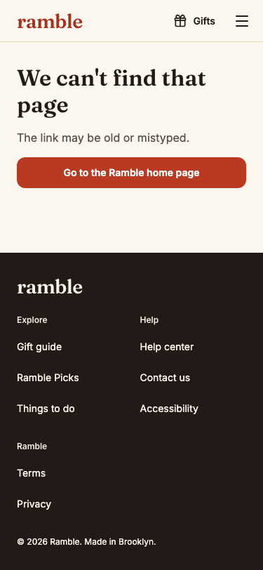

Audit BC-50: the checkout group's not-found and error states rendered the unstyled `SiteShell` (raw links, bare footer), so a mistyped order link or `/gift` with no token looked broken. Both now render inside `GuestShell`, as the rest of the checkout group does.

## What changed
- `src/app/(checkout)/not-found.tsx` and `error.tsx` wrap `NotFoundNotice` and `ErrorNotice` in `GuestShell` with no banner (ADR 0007).
- New tests for each state (guest frame, skip link, nav, footer, retry). `tests/checkout-no-sentry.test.ts` now asserts the closure reaches `GuestShell`.

## Evidence
Before / after at 375 px, `/orders/RMB-NOPE00`:

 

## Checks
review, spec, architecture and qa PASS on round 1; qa mutation checks (revert either file to SiteShell) fail the frame test. e2e did not run: port 3100 was held by another server.

## Follow-ups logged, not built
- Next passes `reset` to error boundaries but `GroupError` types its prop as `retry`; check the Try again wiring (also in the `(guest)` boundary).
- A route-level check that the mistyped link shows the frame.

🤖 Generated with [Claude Code](https://claude.com/claude-code)
