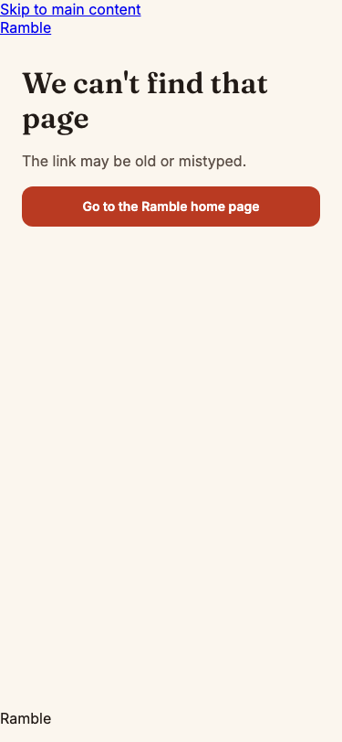
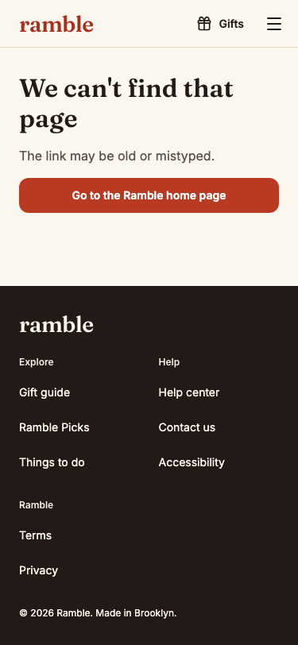
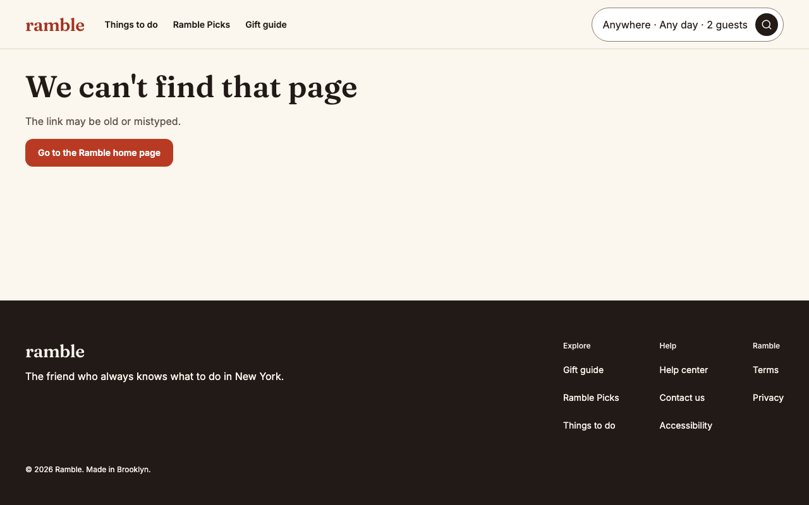

PASS

## qa-agent: U-030 (head b1f3b19), round 2

### Blocking
None.

### Results
- pnpm test: 262 files, 6644 tests pass.
- CI=1 e2e security-headers.spec.ts: 79 passed, 0 failed (the previous head failed 14 checkout-group paths). Full e2e: 163 passed, 6 skipped, 0 failed.
- Mutations: GuestShell back in (checkout)/error.tsx fails 14 security-headers e2e tests (no unit guard, which is in BC-58); SiteShell in (site)/error.tsx or not-found.tsx fails its test.

### Non-blocking
- No vitest guard for the round 1 bug; the e2e is the only guard.

### Evidence
- orders-notfound-375-light-before.png / -after.png: /orders/RMB-NOPE00 at 375 px, raw links then guest frame.  
- gift-notoken-1280-light-after.png: /gift with no token at 1280 px in the guest frame. 
- orders-notfound-1280-light, gift-notoken-375-light: same, valid. No error-state shots exist.
