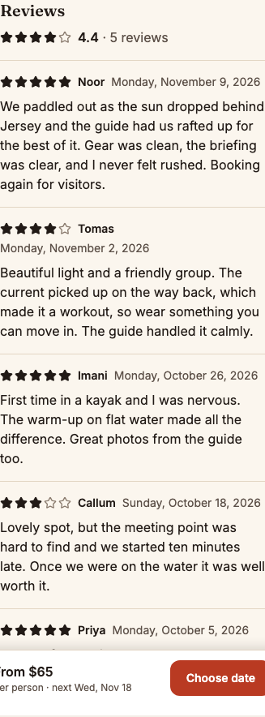
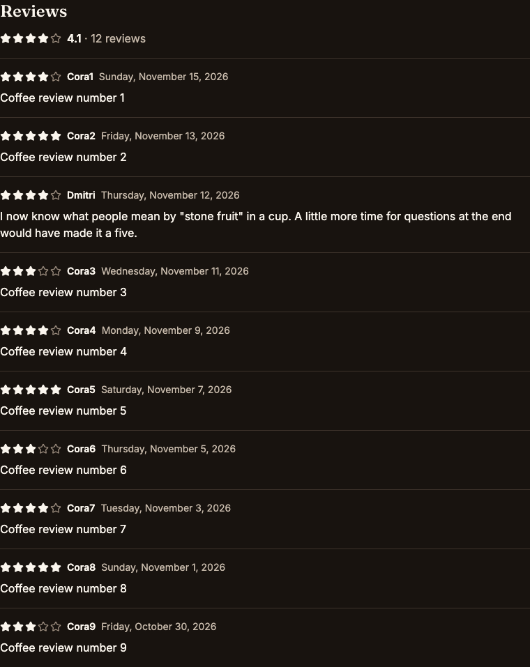
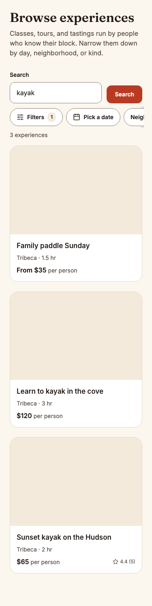
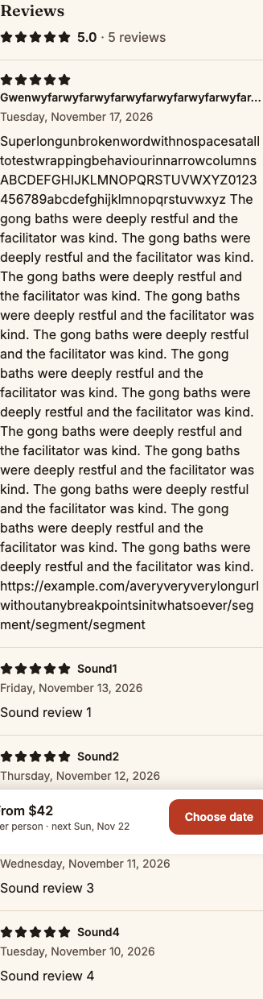
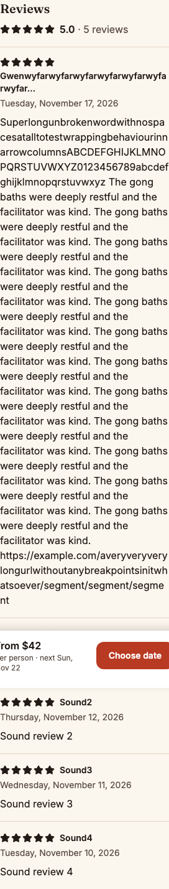

VERDICT: PASS

QA, PR 1033, run on badabdaf (later rounds are refactors, all gates and the shared e2e rerun green on f99d82332e25dcc76f1438017cccf21856c2b6d3). Production build, own database, 375/1280/320, light and dark. All flows pass, no defects:
- Kayak (5 reviews): Reviews section "4.4 · 5 reviews", newest first, first names only, no email in HTML. 
- Under 5 reviews: no section, no card rating. Threshold 4 to 5 appears; 12 reviews list 10 and summarise 12; a hidden review is excluded from list, count and average. 
- Browse and home cards show "Rated X out of 5 from N reviews" only past the threshold. 
- Real flow: /ops/dev send invite, emailed link, 5-star review: the section and card update with no rebuild (cache tag). 
- 320px: long unbroken names, words and URLs wrap with no horizontal scroll. 
a11y (inside qa): axe wcag2a/aa/21/22aa on 3 pages, light and dark, 375 and 1280: 0 violations; one h2, ul/li list, stars aria-hidden, spoken "Rated N out of 5". a11y-audit: APPROVE (advisories: empty-star contrast 3.8:1 on light canvas is thin, rounded stars beside the exact number).
Evidence: evidence/pr/unit-U-044-review-display/ (before/after and qa-*.png) in ramble-pm.
