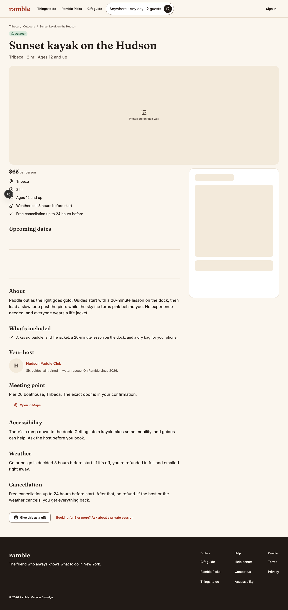
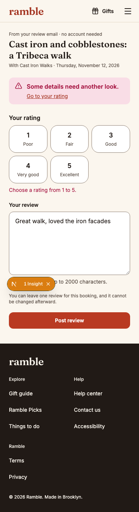
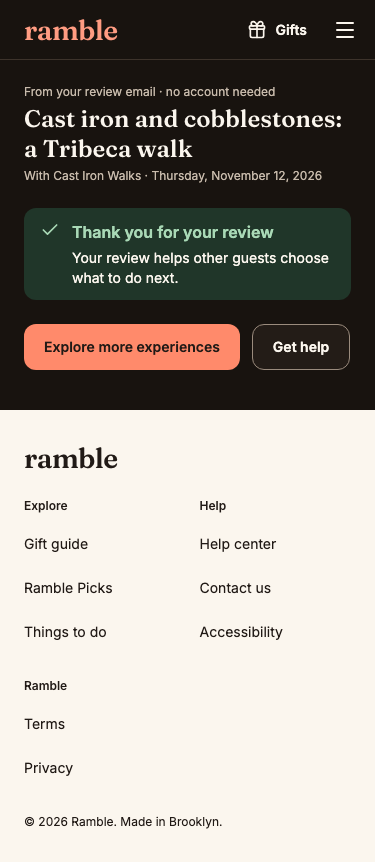
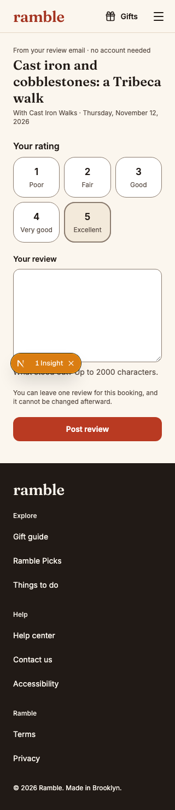

Round 4 head 05656f00d7debd980f0bafc74cdf6adf9b1599c1. Delta since 9c15e850: the review seed reads the terms document through its own db client (CI e2e seed failed on dbRead, the Neon HTTP driver), plus a merge of main (U-076a). Reviewed by the agent on that delta: APPROVE.
The QA run below was on 9c15e850; the delta touches only the seed read (no UI or flow change). All gates and the shared e2e rerun green on this head, and a CI-faithful pnpm db:seed on plain Postgres finishes.

VERDICT: PASS

QA, PR 1024, head 9c15e850, own database, dev server on port 3200, Playwright scripts, 375/1280 (and 320) in light and dark. All nine flows pass with no defects.

| # | Flow | Result | Evidence |
|---|---|---|---|
| 1 | Seeded reviews: 9 on 4 experiences, 11 past bookings | PASS |  |
| 2 | /ops/dev "Send invite now" queues the invite, email in dev mailbox | PASS | qa-r2-02 to 04 |
| 3 | Invalid submit keeps rating and text; summary link moves focus to the field | PASS |  |
| 4 | Valid submit, then reopen shows already reviewed | PASS | qa-r2-09, qa-r2-10-reopen |
| 5 | JavaScript off: submit succeeds, no 500 | PASS |  |
| 6 | Malformed, unknown, expired, refunded: no form, no error; submit refused with 0 rows written | PASS | qa-r2-15 to 17 |
| 7 | 320px tiles: no overflow, 3+2 wrap | PASS |  |
| 8 | Rate limit (30 per 10 minutes per token) | PASS | qa-r2-22 |
| 9 | Keyboard and focus ring on the checked tile | PASS | qa-r2-19 to 21 |

a11y (inside qa): axe wcag2a/aa/21/22aa on the form, 375px light and dark: 0 violations. Tile border contrast 3.8 to 4.09 light, 5.09 to 5.59 dark; focus ring 5.9:1. a11y-audit round 3: APPROVE, no blocking items. Advisories: the jump link targets a visually hidden radio (focus moved correctly in QA); the checked tile relies on :has().

Observations: the inputs are required, so the browser's own bubble stops an empty submit before the server summary (product call); no minimum body length; the public experience page did not show the seeded reviews in dev (display is U-044). Not tested: a built server, error and success states under axe. Full PNG set: evidence/pr/unit-U-060-review-invites/qa-r2-*.png in ramble-pm.
