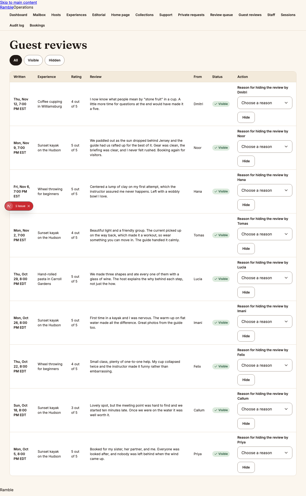
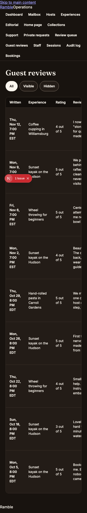
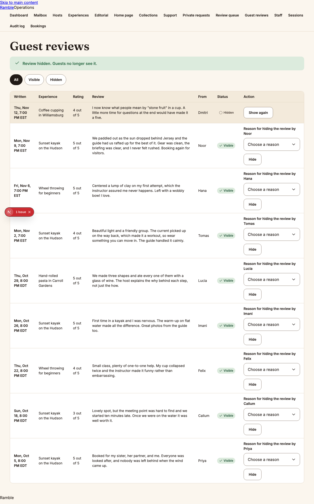
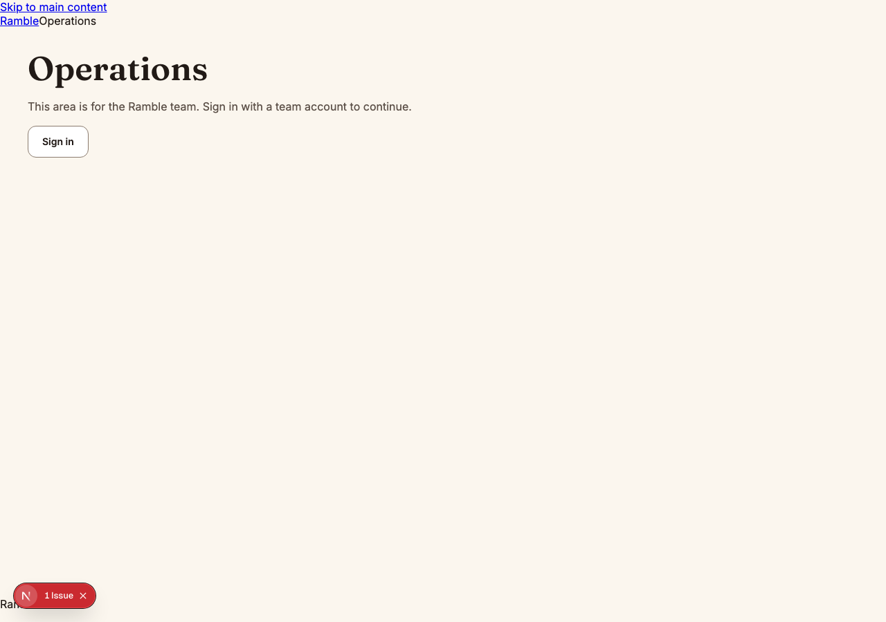
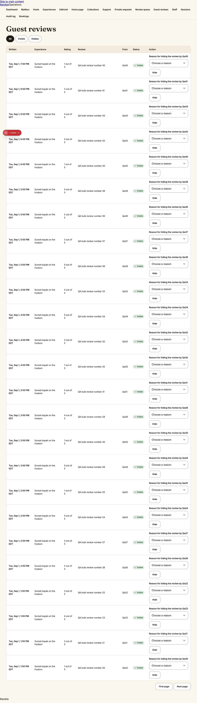
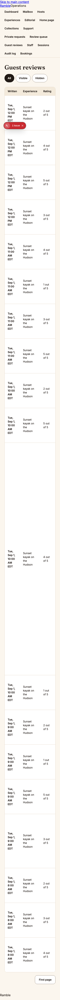

VERDICT: PASS

QA, PR 1037, run on aedc5cf (round 2 is refactors, aria-labels and copy; all gates and the shared e2e rerun green on 82419476449df898bfcceca1ac5e4e044fbc9a8c). Dev server, own database, ops persona via the dev mailbox, 375/1280/320, light and dark. All flows pass:
- /ops/reviews lists the 9 seeded reviews newest first, first name only, no address.  
- Filters All/Visible/Hidden; hide with each of the 5 reason codes writes one review.hidden audit row with the reason; hiding again is a no-op with no second audit row; Show again writes review.unhidden. 
- Hiding one of the kayak's 5 reviews removes the Reviews section and the card rating with no rebuild; show again restores them. 
- Signed-out, guest, host and admin get the gate and cannot call the actions (checked by direct POST). 
- 69 reviews page 25/25/19 with stable order. 
- 320px: no overflow, labelled focusable scroll region, long bodies wrap; keyboard pass good. 
a11y (inside qa): axe wcag2a/aa/21/22aa on pages 1 and 2, light and dark: 0 violations. a11y-audit: APPROVE (advisories addressed in round 2: row-identifying button and select names; remaining: focus returns to the top after a form post; success notice is a status region present at load).
Defects found by QA: stale Show again notice wording (fixed in round 2: "That review is already visible."); filter and cursor lost after an action (logged as a suggestion).
Not tested: a production build (cache refresh was seen on the dev server). Evidence: evidence/pr/unit-U-061-review-moderation/qa-*.png in ramble-pm.
